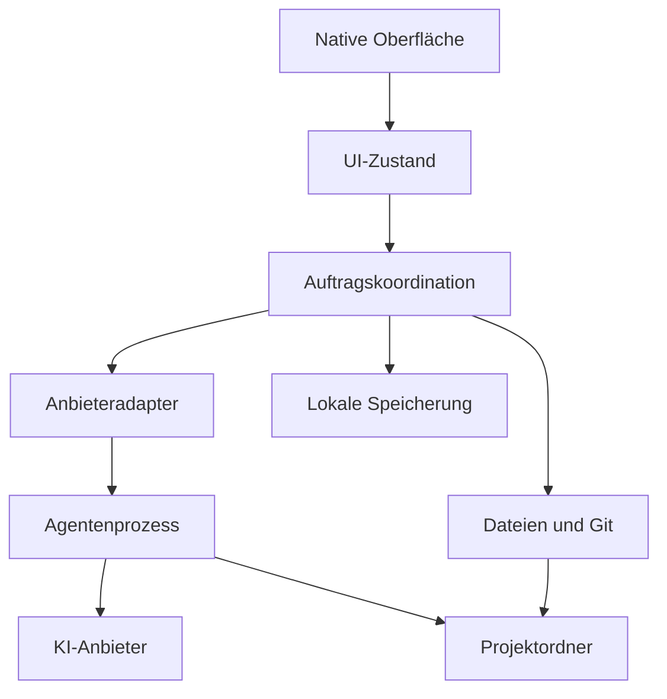

# NativeAgent – vollständiges Konzept für einen schlanken macOS-Coding-Client

**Arbeitstitel:** NativeAgent  
**Dokumentversion:** 1.0  
**Stand:** 11. Oktober 2026  
**Plattform:** ausschließlich macOS  
**Ziel:** eine schnelle native Oberfläche für Coding-Agenten wie Codex und Claude Code, inspiriert vom Funktionsprinzip von T3 Code.

> Dieses Dokument ist eine umsetzbare Produktspezifikation und Architekturvorlage. Die Architektur, Prioritäten und Ressourcenbudgets sind eigene Projektentscheidungen. Anbieterfunktionen müssen mit der tatsächlich installierten CLI-Version geprüft werden. Leistungswerte sind Entwicklungsziele, keine gemessenen Ergebnisse.

## Inhaltsverzeichnis

1. Produktidee und verbindliche Entscheidungen
2. Funktionsumfang und Prioritäten
3. Technologie und Abhängigkeiten
4. Oberfläche und Bedienung
5. Zentrale Nutzerabläufe
6. Anbieter, Anmeldung und Abrechnung
7. Systemarchitektur und Zuständigkeiten
8. Codex-Integration
9. Claude-Code-Integration und weitere Anbieter
10. Prozessverwaltung und Kommunikation
11. Zustände, Streaming und Wiederherstellung
12. Projekte, Dateien und Kontext
13. Codeansichten, Änderungen und Git
14. Terminal und Befehlsausführung
15. Datenmodell und Speicherung
16. Berechtigungen und macOS-Integration
17. Performance und Ressourcenbudgets
18. Fehlerbehandlung und Diagnose
19. Einstellungen und Tastenkürzel
20. Projektstruktur und Komponenten
21. Qualitätsprüfung und Abnahmekriterien
22. Entwicklungsphasen
23. Distribution, Updates und Betrieb
24. Technische Risiken und zu klärende Punkte
25. Implementierungsauftrag für eine Coding-KI
26. Quellen

## 1. Produktidee und verbindliche Entscheidungen

NativeAgent ist eine lokale macOS-App, in der der Nutzer Projektordner öffnet, mit einem Coding-Agenten arbeitet, dessen Aktionen verfolgt und Codeänderungen überprüft. Die App soll im Alltag schnell starten, flüssig reagieren und im Leerlauf kaum CPU benötigen.

Das KI-Modell läuft beim jeweiligen Anbieter. Lokal laufen die Oberfläche, Projektverwaltung und Agentenprogramme. Befehle, Tests, Compiler und lokale Entwicklungsserver können unabhängig von der Oberfläche Ressourcen verbrauchen.

| Bereich | Entscheidung |
|---|---|
| Hauptsprache | Swift |
| Oberfläche | SwiftUI; AppKit gezielt für leistungsfähige Text- und Codeansichten |
| Entwicklungsumgebung | Xcode |
| Mindestversion | macOS 14 als anfängliches Deployment-Ziel; im ersten Prototyp bestätigen |
| Architektur | Apple Silicon zuerst; Intel-Unterstützung nach gesondertem Bedarf und Prüfung der Anbieterprogramme |
| Lokale Kommunikation | Prozesse und Pipes; für Codex JSON-basierte Kommunikation über Standard-Ein-/Ausgabe |
| Speicherung | SQLite mit versionierten Migrationen |
| Erster Anbieter | Codex über den offiziellen App Server |
| Zweiter Anbieter | unverändertes offizielles Claude-Code-Programm mit eigenem Adapter |
| Weitere Anbieter | Erweiterung über eine interne Adapter-Schnittstelle |
| Betrieb | lokal auf dem Mac; kein eigener Cloud-Backend-Server für die Grundfunktionen |
| Erstes Produktziel | zuverlässig mit einem Projekt und einem laufenden Auftrag arbeiten |
| Distribution | zunächst lokal bauen; bei Veröffentlichung signierte und notarisierte Direktdistribution |
| Design | native macOS-Bedienung, kompakte Oberfläche, klare Statusanzeigen |

SwiftUI unterstützt die Kombination mit AppKit. Das ist die Grundlage für die vorgeschlagene Mischung aus nativer App-Oberfläche und spezialisierten Textansichten. [Q1]

### 1.1 Was der Nutzer damit machen soll

- Ein vorhandenes Git-Projekt oder einen gewöhnlichen Ordner öffnen.
- Einen Anbieter verbinden und ein tatsächlich verfügbares Modell auswählen.
- Aufgaben wie „Behebe diesen Fehler“, „Erkläre diese Datei“ oder „Baue dieses Feature“ stellen.
- Antworten und Agentenaktionen live verfolgen.
- Angefragte Berechtigungen erteilen oder ablehnen.
- Änderungen und Befehlsausgaben überprüfen.
- Gespräche nach einem Neustart fortsetzen, soweit der Anbieter dies unterstützt.
- Zwischen Projekten wechseln, ohne unnötig alle Inhalte und Agentenprozesse zu laden.

### 1.2 Leitprinzipien

1. **Native Bedienung:** Menüs, Fenster, Auswahl, Textdarstellung und Shortcuts folgen macOS-Konventionen.
2. **Begrenzter Ressourcenverbrauch:** jede größere Liste, Ausgabe und Hintergrundaufgabe erhält ein nachvollziehbares Limit.
3. **Echte Integration:** angezeigte Funktionen werden durch reale Anbieteraktionen ausgelöst.
4. **Klare Zuständigkeit:** der Agent führt Agentenarbeit aus; die App organisiert und stellt sie dar.
5. **Nachvollziehbarer Zustand:** bereit, arbeitet, wartet auf Freigabe, unterbrochen und fehlgeschlagen sind unterscheidbar.
6. **Ehrliche Funktionsanzeige:** ein Adapter zeigt nur Funktionen, die seine geprüfte Version unterstützt.

## 2. Funktionsumfang und Prioritäten

**P0** ist für die erste alltagstaugliche Version erforderlich. **P1** erweitert sie nach erfolgreicher Abnahme. **P2** ist optional und wird erst bei einem konkreten Bedarf umgesetzt.

| Funktion | Priorität | Beschreibung |
|---|---|---|
| Projektordner öffnen | P0 | vorhandenen lokalen Ordner auswählen und merken |
| Projektliste | P0 | zuletzt verwendete Projekte, Suche, Entfernen aus der App |
| Codex erkennen | P0 | ausführbaren Pfad, Version und Startfähigkeit prüfen |
| ChatGPT-Anmeldung | P0 | offiziellen Codex-Anmeldeweg auslösen |
| Neues Gespräch | P0 | Projekt und Anbieter zuordnen |
| Gespräch fortsetzen | P0 | lokale Zuordnung zum Anbieter-Gespräch wiederverwenden |
| Modellwahl | P0 | verfügbare Modelle vom Anbieter laden |
| Nachrichten und Streaming | P0 | laufende Ausgabe mit stabiler Darstellung |
| Stoppen | P0 | Auftrag geordnet unterbrechen |
| Agentenaktionen | P0 | Dateiarbeit und Befehle als eigene Einträge |
| Berechtigungsanfragen | P0 | reale Anbieteranfragen anzeigen und beantworten |
| Rückfragen | P0 | unterstützte Anbieter-Rückfragen darstellen |
| Dateibaum | P0 | bedarfsgerecht geladene Projektansicht |
| Dateivorschau | P0 | Text und Code lesen, Zeilennummern, Kopieren |
| Änderungsansicht | P0 | Unified Diff, Dateien mit Änderungen |
| Git-Status | P0 | Branch, geänderte und neue Dateien |
| Lokaler Verlauf | P0 | Liste und Anzeigekopie; Anbieterhistorie bleibt gesondert |
| Logausgabe von Befehlen | P0 | begrenzte, durchsuchbare Ausgabe |
| Offline-Verlauf | P0 | vorhandene Inhalte ohne Anbieterzugang lesen |
| Einstellungen | P0 | Pfade, Darstellung, Limits und Diagnose |
| Datei bearbeiten | P1 | einfacher nativer Editor mit Konflikterkennung |
| Staging und Commit | P1 | ausgewählte Änderungen explizit übernehmen |
| Eingebettetes Terminal | P1 | echtes PTY mit Terminaldarstellung |
| Claude Code | P1 | eigenes Abnahme-Gate für Auth, Streaming und Berechtigungen |
| Globale Verlaufssuche | P1 | begrenzter lokaler Suchindex |
| Dateisuche und Kontextverweise | P1 | Dateien und Zeilen gezielt referenzieren |
| Mehrere Fenster | P1 | gespeicherte Projekte in separaten Fenstern |
| Worktrees | P2 | parallele Arbeit in getrennten Arbeitsverzeichnissen |
| Bildanhänge | P2 | nur bei ausgewiesener Modellunterstützung |
| MCP und Erweiterungen | P2 | Anbieterfunktionen sichtbar verwalten |
| Weitere Anbieter | P2 | geprüfte offizielle CLI- oder API-Anbindung |
| API-Keys als Zusatzoption | P2 | eigene Schlüssel mit klarer Abrechnungsanzeige |

### 2.1 Grenzen der ersten Version

Die erste Version ist ein Coding-Client und kein vollständiger IDE-Ersatz. Der Nutzer kann Dateien in Xcode, VS Code oder einem anderen Editor öffnen. Sprachserver, vollständiges Debugging und ein umfangreiches Plugin-System sind spätere Einzelentscheidungen.

Die App erhält eine eigene Gestaltung und einen eigenen Namen. „T3-Clone“ beschreibt die gewünschte Arbeitsweise. Ein Markenname, fremde Logos oder fremder Quellcode werden dadurch nicht Teil des eigenen Produkts.

## 3. Technologie und Abhängigkeiten

### 3.1 Vorgeschlagener Stack

| Aufgabe | Umsetzung | Begründung |
|---|---|---|
| App-Lebenszyklus und Fenster | SwiftUI App, ergänzend AppKit | native Integration |
| Ansichten und Navigation | SwiftUI | klare deklarative Oberfläche |
| Langer Text und Code | AppKit `NSTextView` | kontrollierbare Darstellung, Auswahl und große Inhalte |
| Zustandsmodell | Observation und klar getrennte View-States | geringe unnötige Aktualisierung |
| Nebenläufigkeit | Swift Concurrency, Actors | voneinander isolierte Prozess- und Datenzustände |
| Prozesse | Foundation `Process`, `Pipe` | direkte lokale CLI-Anbindung |
| PTY-Terminal | kleiner PTY-Baustein und native Terminalbibliothek | später eigenständig austauschbar |
| Datenbank | SQLite; Zugriff hinter eigenem Repository | kleiner lokaler Datenbestand, Migrationen |
| Eigene API-Geheimnisse | macOS Keychain | getrennt von Verlauf und Einstellungen |
| Einstellungen | `UserDefaults` für kleine Präferenzen | einfache lokale Verwaltung |
| Dateibeobachtung | ereignisbasierte Systembeobachtung | wenig Leerlaufarbeit |
| Diagnose | `Logger`, Instruments und Signposts | gezielt messen und Fehler eingrenzen |

Diese Auswahl ist eine Architekturentscheidung. Die konkreten Apple-APIs müssen gegen das gewählte Deployment-Ziel kompiliert und geprüft werden.

### 3.2 Abhängigkeitsstrategie

- Apple-Frameworks und Systembibliotheken bevorzugen.
- Drittanbieter nur einsetzen, wenn sie eine schwierige Aufgabe wesentlich vereinfachen.
- Alle externen Pakete mit konkreter Version und Lizenz dokumentieren.
- Ein SQLite-Wrapper ist optional; ein direkter Zugriff darf nicht zu verstreuten SQL-Aufrufen führen.
- Ein Terminal-Renderer wird erst mit dem interaktiven Terminal eingebunden.
- Die Hauptoberfläche, Markdown-Ausgabe und Diffs werden nativ dargestellt.
- Anbieterprogramme werden zunächst vom Nutzer installiert. Das App-Paket enthält in P0 nur den Client.

### 3.3 Entwicklungsvoraussetzungen

Benötigt werden ein kompatibles macOS, Xcode und die Command Line Tools. Für den ersten Anbieter wird eine funktionierende Codex-Installation vorausgesetzt. Ein eigenes ChatGPT-Konto mit entsprechendem Codex-Zugang wird im offiziellen Anmeldeweg verbunden. Für Git-Funktionen muss Git verfügbar sein.

Der GUI-Client erhält keine generelle Node.js- oder Python-Abhängigkeit. Welche Laufzeit ein externes Anbieterprogramm benötigt, wird bei der Anbieterprüfung separat ausgewiesen.

## 4. Oberfläche und Bedienung

### 4.1 Fensteraufteilung

| Bereich | Inhalt | Verhalten |
|---|---|---|
| Linke Seitenleiste | Projekte und Gespräche | einklappbar; nur aktive Liste laden |
| Hauptbereich | Gespräch, Aufgabenstatus und Eingabe | wichtigste Arbeitsfläche |
| Rechte Seitenleiste | Dateien, Änderungen und Details | kontextabhängig; einklappbar |
| Unterer Bereich | Befehlsausgabe; später Terminal | nur bei Bedarf öffnen |
| Toolbar | Projekt, Anbieter, Modell und Status | kompakt, gut lesbar |

Empfohlene Startgröße: ungefähr 1.280 × 820 Punkte. Bei kleineren Fenstern ist die rechte Seitenleiste standardmäßig geschlossen. Breiten und Sichtbarkeit werden pro Fenster gespeichert. Harte Mindestbreiten dürfen die App auf einem MacBook-Display nicht unbenutzbar machen.

### 4.2 Gestaltung

- Systemschrift für normalen Text; Monospace für Code, Pfade und Befehle.
- Systemfarben und dezente Akzente, mit hellem und dunklem Modus.
- Zurückhaltende Animationen; die macOS-Einstellung für reduzierte Bewegung berücksichtigen.
- Keine dauerhaft animierten Hintergründe oder regelmäßigen visuellen Effekte im Leerlauf.
- Status nicht nur über Farbe vermitteln: Symbol und Beschriftung ergänzen.
- Lange Pfade visuell kürzen, vollständig kopierbar halten.
- Textauswahl, Kontextmenüs und Tastaturfokus funktionieren in allen relevanten Ansichten.

### 4.3 Gesprächsdarstellung

Das Gespräch enthält getrennte Einträge für Nutzertext, Agentenantwort, Befehlslauf, Dateiänderung, Rückfrage und Fehler. Ausgaben von Werkzeugen sind anfangs kompakt. Der Nutzer kann einzelne Einträge aufklappen.

Während des Streamings soll das Layout stabil bleiben. Automatisches Scrollen erfolgt nur, solange der Nutzer am Ende des Gesprächs bleibt. Beim Lesen älterer Nachrichten zeigt eine Schaltfläche neue Aktivität an.

Codeblöcke haben einen Kopierknopf, Sprache als optionalen Hinweis und einen kontrollierten horizontalen Scrollbereich. Große Tabellen, riesige Codeblöcke und lange URLs erhalten definierte Darstellungsgrenzen.

### 4.4 Eingabefeld

- Mehrzeiliger nativer Texteingang.
- Senden über `⌘Return`; Zeilenumbruch über Return.
- Entwurf pro Gespräch speichern.
- Klarer Stoppen-Knopf während eines Auftrags.
- Projekt und gewähltes Modell bleiben erkennbar.
- Anhänge und Dateiverweise werden als separate Kontextobjekte verwaltet.
- Ein großer Prompt löst eine Größenprüfung vor dem Senden aus.

### 4.5 Freigaben

Eine Freigabe zeigt die tatsächlich angefragte Aktion, Arbeitsverzeichnis, angefragten Umfang und verfügbare Entscheidungen. Sie wird als Karte im zugehörigen Gespräch und bei Bedarf in einem Sheet präsentiert.

Nur Entscheidungen anbieten, die der Adapter wirklich übertragen kann. Eine allgemeine Schaltfläche „Immer erlauben“ ist ohne entsprechende Anbieterfunktion unzulässig. Eine Freigabe aus einem alten, abgeschlossenen Auftrag wird als erledigt angezeigt und kann nicht erneut gesendet werden.

## 5. Zentrale Nutzerabläufe

### 5.1 Erststart

1. Eine kurze Einführung erklärt: Projekte bleiben lokal; Agenten übertragen ihre benötigten Daten an den gewählten Anbieter.
2. Der Nutzer öffnet einen Projektordner.
3. Die App zeigt erkannte Agentenprogramme und fehlende Voraussetzungen.
4. Codex wird geprüft und der offizielle Login gestartet oder ein bestehender Login erkannt.
5. Die App zeigt den tatsächlichen Verbindungsstatus.
6. Ein neues Gespräch im gewählten Projekt ist bereit.

Installationshinweise sind konkret, kopierbar und freiwillig. Der Client lädt oder aktualisiert externe ausführbare Dateien erst auf ausdrückliche Nutzeraktion.

### 5.2 Feature entwickeln

1. Projekt öffnen und Git-Status lesen.
2. Gespräch erstellen und verfügbares Modell wählen.
3. Auftrag eingeben, optional relevante Dateien referenzieren.
4. Agentenarbeit verfolgen und erforderliche Freigaben beantworten.
5. Ergebnis und Änderungen prüfen.
6. Tests über den Agenten oder eine explizite lokale Aktion starten.
7. In P1 ausgewählte Änderungen stagen und einen Commit erstellen.

Ein Auftrag endet mit einem klaren Status und verfügbaren Ergebnissen. Eine erfolgreiche Antwort ist kein Beweis für einen erfolgreichen Build; ausgeführte Tests erhalten ihre eigenen Resultate.

### 5.3 Projekt wechseln

Ein Projektwechsel speichert den Entwurf und UI-Zustand. Ein laufender Auftrag bleibt sichtbar. Der Nutzer kann ihn weiterlaufen lassen oder unterbrechen. Das bloße Verlassen einer Ansicht beendet keinen Prozess.

### 5.4 Verbindung verlieren

Die Oberfläche kennzeichnet den Auftrag zunächst als „Zustand wird geprüft“. Nach Wiederverbindung fragt der Adapter den Anbieterzustand ab. Die App sendet den ursprünglichen Auftrag nicht automatisch erneut.

### 5.5 App schließen

Bei laufenden Aufträgen wird eine konkrete Auswahl angezeigt: geöffnet lassen oder Aufträge stoppen und schließen. P0 bietet keine unbeabsichtigte Hintergrundausführung nach dem Schließen. Ein späterer Hintergrundmodus benötigt ein eigenes Betriebskonzept.

## 6. Anbieter, Anmeldung und Abrechnung

### 6.1 Unterstützungsmodell

| Anbieterweg | Anmeldung | Zugangsart | Geplanter Status |
|---|---|---|---|
| Codex App Server | offizieller ChatGPT-Login | vorhandener Codex-Zugang des Kontos | P0 |
| Codex mit API-Key | offizieller API-Key-Weg | separate API-Abrechnung | optional P2 |
| Claude Code | Login des unveränderten offiziellen CLI-Programms | eigener unterstützter Claude-Zugang | P1 nach Prüfung |
| Direkte Claude API | eigener API-Key | separate API-Abrechnung | optional P2 |
| Weitere Anbieter | jeweils dokumentierter Authentifizierungsweg | anbieterabhängig | P2 |

Codex unterscheidet zwischen ChatGPT-Anmeldung für Abo-Zugang und API-Key-Anmeldung mit nutzungsabhängiger API-Abrechnung. Die App muss beides eindeutig beschriften. [Q3]

Anthropic erlaubt unter beschriebenen Bedingungen das Ausführen des unveränderten Claude-Code-Programms, in dem Endnutzer ihren eigenen Zugang anmelden. Das ist von einem eigenen Claude.ai-Login eines Drittanbieterprodukts zu unterscheiden. Die App sammelt, kopiert oder vermittelt keine Claude-Abo-Tokens. Bei Veröffentlichung sind insbesondere die Bedingungen für das Anbieten von Claude Code in einem Produkt zu erfüllen. [Q4]

### 6.2 Darstellung in der App

Anbieterstatus: „Nicht installiert“, „Nicht verbunden“, „Bereit“, „Anmeldung läuft“, „Limit erreicht“, „Version nicht unterstützt“ oder „Verbindung fehlgeschlagen“.

Kontoinformationen nur anzeigen, wenn der Anbieter sie liefert. Der Client erfindet keine verbleibenden Credits, Reset-Zeiten, Modellrechte oder Kosten. Fehlt eine Information, lautet die Anzeige „Nicht verfügbar“.

### 6.3 Umgang mit bestehender Anmeldung

Der Nutzer kann einen bestehenden lokalen Codex- oder Claude-Code-Zugang verwenden. Die App zeigt vor dem Verbinden, welches Anbieterprofil beziehungsweise welche Konfiguration verwendet wird.

Bei einem gemeinsam mit dem CLI genutzten Profil kann eine Abmeldung auch andere Clients betreffen. Die App erklärt diesen konkreten Effekt vor dem Logout. Sie kopiert dafür keine Authentifizierungsdateien in ihre eigene Datenbank.

### 6.4 Anbieterwechsel

Neue Gespräche können einen anderen Anbieter nutzen. Ein bestehendes Gespräch bleibt an sein Anbieterprofil gebunden. Eine spätere Übergabe an einen anderen Anbieter erzeugt ein neues Gespräch mit einer ausdrücklich ausgewählten Zusammenfassung; sie ist keine nahtlose Fortsetzung desselben Anbieterzustands.

Für P0 gilt: ein Standard-Codex-Profil. Mehrere Konten und getrennte Konfigurationsverzeichnisse werden erst mit sauberer Historienisolierung ergänzt.

## 7. Systemarchitektur und Zuständigkeiten

### 7.1 Komponentenmodell



Die Grafik zeigt Zuständigkeiten. Insbesondere bedeutet die Verbindung vom Agentenprozess zum Projekt, dass Dateizugriffe auch innerhalb der Agentenlaufzeit stattfinden können. Der native Datei-Service ist nicht automatisch eine Sicherheitsgrenze für den Agenten.

### 7.2 UI-Schicht

SwiftUI-Views bleiben möglichst deklarativ. Sie lesen schlanke View-States und senden Nutzeraktionen an einen Coordinator. Prozessstart, SQL, Diff-Berechnung und Dateisuche gehören nicht in View-Bodies.

UI-Zustände werden am Main Actor aktualisiert. Größere Verarbeitungsschritte erfolgen außerhalb des Main Actors und liefern darstellungsfertige Ergebnisse.

### 7.3 Anwendungsschicht

Der `SessionCoordinator` ordnet Aufträge, Projekte, Anbieterprofile und Ereignisse zu. Er sorgt für erlaubte Zustandsübergänge, verhindert doppelte Starts und entscheidet, welche Ergebnisse gespeichert beziehungsweise dargestellt werden.

Fenster besitzen eigene Auswahlzustände. Gemeinsame Dienste verwalten dieselben Projekte, Profile und laufenden Aufträge. Zwei Fenster dürfen denselben aktiven Auftrag nicht unbemerkt doppelt starten.

### 7.4 Domänenschicht

Kernobjekte: `Project`, `ProviderProfile`, `Conversation`, `Turn`, `TimelineItem`, `ApprovalRequest`, `ContextReference`, `FileChangeSummary` und `RuntimeStatus`.

Anbieterabhängige Felder bleiben hinter Adaptern. Ein Claude-Ereignis wird nicht zwanghaft in eine Codex-Struktur gepresst. Die gemeinsame Timeline unterstützt zusätzliche, gekennzeichnete Detailinformationen.

### 7.5 Dienste

| Dienst | Aufgabe |
|---|---|
| `ProviderRegistry` | verfügbare Adapter und deren Fähigkeiten |
| `SessionCoordinator` | Auftrags-Lebenszyklus und Ereigniszuordnung |
| `ProcessSupervisor` | gestartete Prozesse, Ausgaben, Ende und Aufräumen |
| `ProjectService` | Projektmetadaten und Ordnerauswahl |
| `FileService` | bedarfsgerechtes Lesen und Beobachten |
| `GitService` | Status, Diff und später explizite Git-Aktionen |
| `DatabaseActor` | Datenbankzugriff und Migrationen |
| `HistoryRepository` | Anzeigekopie, Suche und Pagination |
| `KeychainService` | ausschließlich eigene Geheimnisse, falls benötigt |
| `DiagnosticsService` | begrenzte Logs und freiwilliger Diagnoseexport |

### 7.6 Erweiterbarkeit

Eine interne, typisierte Adapter-Schnittstelle ist für die ersten Anbieter ausreichend. Ein dynamisches Drittanbieter-Plugin-System würde zusätzliche Lade-, Sicherheits- und Versionsprobleme schaffen und ist zunächst nicht Teil der Architektur.

## 8. Codex-Integration

### 8.1 Offizieller Integrationsweg

Der Codex App Server ist die dokumentierte Schnittstelle für eigene Clients mit Authentifizierung, Historie, Freigaben und Agentenereignissen. Die lokale Verbindung verwendet hier `stdio` mit zeilengetrenntem JSON. Vor anderen Aufrufen erfolgt `initialize`, danach `initialized`. [Q2]

```bash
codex app-server
```

Wichtige Methoden für den Adapter:

| Methode | Zweck |
|---|---|
| `account/read` | Accountstatus |
| `account/login/start` | offizieller Login |
| `model/list` | verfügbare Modelle |
| `thread/start` | Gespräch erstellen |
| `thread/resume` | Gespräch fortsetzen |
| `thread/read` | Historie lesen |
| `turn/start` | Auftrag starten |
| `turn/interrupt` | Auftrag unterbrechen |

Parameter und Ereignisformen werden gegen die eingesetzte Version geprüft. Die CLI kann ihre JSON-Schemata exportieren:

```bash
codex app-server generate-json-schema --out ./schemas
```

Schemaexporte werden als Entwicklungsreferenz versioniert. [Q2]

### 8.2 Geplanter Adapter

Der Adapter erhält eine kleine Kompatibilitätsschicht. Sie übersetzt geprüfte Anbieterobjekte in die App-Domäne. Verfügbare Modelle und deren Einstellmöglichkeiten werden geladen; die App speichert keine vermeintlich allgemeingültige Modellliste. [Q2]

Für die Implementierung gelten folgende eigene Anforderungen:

- Einen normalen lokalen Codex-Prozess pro aktivem Anbieterprofil verwalten.
- Transport und Datentypen getrennt halten.
- UI-Ereignisse mit Projekt, Gespräch und Auftrag verbinden.
- Serveranfragen unabhängig von Clientanfragen beantworten.
- Unbekannte Ereignisse diagnostizieren, ohne das ganze Gespräch zu beschädigen.
- Die Menge gleichzeitig geladener Anbieterhistorie begrenzen.
- Die Anbieterhistorie mit der lokalen Anzeigekopie abgleichen, statt zwei Wahrheiten zusammenzumischen.
- Experimentelle Funktionen erst nach einer eigenen Kompatibilitätsprüfung aktivieren.

### 8.3 ChatGPT-Anmeldung

Die App löst den offiziellen Browser-Anmeldeweg aus und öffnet die vom Anbieter gelieferte URL. Nach Abschluss prüft sie den tatsächlichen Accountstatus. Passwörter oder Abo-Tokens werden nicht in NativeAgent eingegeben oder in dessen SQLite-Datenbank gespeichert. Ein gültiger bestehender CLI-Login kann weiterverwendet werden. [Q3]

Der Anmeldevorgang darf abgebrochen werden. Wenn der Nutzer den Browser schließt, bleibt eine verständliche Möglichkeit zum erneuten Start. Ein abgeschlossenes Login wird nicht aus einer geöffneten Browserseite abgeleitet, sondern aus der Anbieterbestätigung.

### 8.4 Verbindliche Abnahme für Codex

Der erste echte vertikale Prototyp muss diese Abfolge erfolgreich ausführen:

1. CLI finden und Version prüfen.
2. Prozess starten und Verbindung initialisieren.
3. Konto prüfen beziehungsweise offiziell anmelden.
4. Modelle laden.
5. Gespräch im Testprojekt erstellen.
6. Nachricht senden und Antwort live anzeigen.
7. Eine echte Berechtigungsanfrage korrekt beantworten.
8. Einen Auftrag unterbrechen.
9. Prozess und App neu starten und das Gespräch fortsetzen.

Erst nach dieser Prüfung wird die größere Oberfläche ausgebaut.

## 9. Claude-Code-Integration und weitere Anbieter

### 9.1 Claude Code als unverändertes Anbieterprogramm

Die geplante Integration führt das offizielle Claude-Code-Programm lokal aus. Installation, Authentifizierung und Abo-Zugang bleiben beim unveränderten Anbieterprogramm. Bei einem Produktangebot müssen die von Anthropic beschriebenen Bedingungen eingehalten werden. Insbesondere werden keine Nutzerzugänge weiterverkauft oder deren Abo-Tokens durch den Client vermittelt. [Q4]

Die Schaltfläche heißt beispielsweise „Claude Code verbinden“. Bei fehlender Anmeldung öffnet sie die offizielle CLI-Anmeldung in einem Terminal. Sie erzeugt keinen eigenen Claude.ai-OAuth-Client.

### 9.2 Technische Stufen

| Stufe | Verhalten | Voraussetzung |
|---|---|---|
| A: CLI-Verbindung | offizielles Programm, tatsächlichen Status und Version prüfen | funktionierende lokale Installation |
| B: Native Timeline | strukturierte Text-, Tool- und Ergebnisereignisse übernehmen | dokumentierte, getestete Ausgabeform |
| C: Native Steuerung | Fortsetzen, Unterbrechen und echte Berechtigungsantworten | geprüfter bidirektionaler Steuerungsweg |

Die CLI dokumentiert einen programmgesteuerten Modus und strukturierte beziehungsweise gestreamte JSON-Ausgabe. Diese Ausgabe allein beweist jedoch keine vollständige native Berechtigungssteuerung. [Q5]

Die App aktiviert die entsprechenden Funktionen jeweils erst nach einem echten Integrationstest. Wenn der geprüfte Modus keine zuverlässigen Freigaberückmeldungen erlaubt, erfolgt interaktive Agentenarbeit im offiziellen CLI innerhalb des PTY-Terminals. Die native Timeline bleibt dann eine optionale Ergänzung.

Ein API-basierter Agent ist eine gesonderte Integration mit gesonderter Abrechnung. Ein TypeScript- oder Python-SDK wird nicht allein für den Swift-Client eingebettet.

### 9.3 Besonderheiten bei Claude

- CLI-Aufrufe und Parameter an die unterstützte Version binden.
- Session-IDs nur aus tatsächlichen Anbieterereignissen übernehmen.
- Nicht blind das letzte CLI-Gespräch fortsetzen; das konkrete Gespräch identifizieren.
- Projektkonfiguration, Hooks und MCP vor automatisiertem Start berücksichtigen.
- „Schneller starten“ darf nicht unbeabsichtigt das Authentifizierungsmodell ändern: laut Dokumentation liest `--bare` keinen Abo-Login. [Q5]
- Eine reine Textausgabe wird nicht durch Analyse zufälliger Terminaltexte als zuverlässige JSON-Schnittstelle ersetzt.

### 9.4 Gemeinsame Fähigkeiten

Der Adapter meldet unter anderem:

```text
supportsSubscriptionAuth
supportsAPIKeyAuth
supportsStructuredStreaming
supportsResume
supportsInterrupt
supportsNativeApprovals
supportsFileChangeEvents
supportsUsageReporting
supportsImageInput
supportsModelDiscovery
```

Diese Werte stammen aus der geprüften Adapterimplementierung und der Anbieter-Version. Ein Anbieter ohne native Freigaben darf keine identisch aussehende, wirkungslose Freigabeoberfläche erhalten.

### 9.5 Weitere Anbieter

Jeder zusätzliche Anbieter braucht einen eigenen Integrationsentwurf: offizieller Zugangsweg, Abrechnung, Prozess- oder API-Schnittstelle, Kontextverwaltung, Werkzeugausführung und Abnahme. Eine allgemeine „Mit jedem KI-Konto anmelden“-Funktion wird nicht als Produktversprechen verwendet.

## 10. Prozessverwaltung und Kommunikation

### 10.1 Prozessstart

Der `ProcessSupervisor` startet eine geprüfte ausführbare Datei mit getrennten Argumenten. Er verwendet für technische App-Aktionen keinen aus Nutzereingaben zusammengesetzten Shellstring.

Vor dem Start werden Pfad, Ausführbarkeit, Version und Arbeitsverzeichnis geprüft. Symbolische Links zum Binary werden aufgelöst und angezeigt, soweit dies für die Diagnose sinnvoll ist.

GUI-Apps bekommen nicht zwingend dieselbe Umgebung wie ein Terminal. Daher:

- bekannte Installationsorte prüfen;
- einen manuell auswählbaren Binary-Pfad erlauben;
- den effektiv verwendeten Pfad in Einstellungen anzeigen;
- Anbieter-Konfiguration und notwendige Umgebungswerte gezielt weitergeben;
- keine Shell-Startdateien bei jedem App-Start ausführen;
- keine globale Änderung von `HOME` zur Accountumschaltung;
- Geheimnisse in Diagnoseausgaben herausfiltern.

### 10.2 Kommunikationsschicht

Ein eigener Actor besitzt den Transportzustand. Ausgaben werden als Bytes gelesen und bis zu vollständigen Frames gesammelt. Ein Lesechunk kann eine halbe Nachricht oder mehrere Nachrichten enthalten; Chunkgrenzen sind keine Nachrichtengrenzen.

Der Decoder unterscheidet Antwort, Benachrichtigung und serverseitige Anfrage. Anfrage-IDs dürfen numerisch oder textuell sein, soweit das Anbieterformat dies vorsieht. Client- und Serveranfragen haben getrennte Verwaltungsbereiche.

Schreibvorgänge werden serialisiert. Jeder Frame erhält genau die erforderliche Abschlussmarkierung. Gleichzeitig wird `stderr` gelesen, damit eine volle Pipe den Prozess nicht blockiert.

### 10.3 Begrenzungen

Anfangs gelten als eigene, konfigurierbare Schutzgrenzen:

| Grenze | Startwert | Verhalten |
|---|---|---|
| Einzelnes Transportframe | 16 MiB | zu großes Frame kontrolliert ablehnen und diagnostizieren |
| Eingehender Rohpuffer | 32 MiB | kein unbegrenztes Wachstum |
| Ausstehende normale RPCs | 64 | neue Anfrage kontrolliert verzögern oder ablehnen |
| Befehlsausgabe im RAM | 2 MiB je aktivem Lauf | ältere Inhalte begrenzt auf Platte oder verworfen |
| UI-Aktualisierung bei Streaming | ungefähr 10–20 Hz | Textdeltas zusammenfassen |
| Schwere Hintergrundarbeiten | höchstens 2 gleichzeitig | Warteschlange und Abbruch unterstützen |

Große Historien werden in Seiten geladen. Ist das größte zulässige Frame für eine reale Anbieterantwort unzureichend, wird ein dokumentierter Ladeweg oder eine gezielte Anpassung vorgesehen. Die App darf nicht einfach abstürzen.

### 10.4 Timeouts und Wiederholungen

Normale kurze Metadatenanfragen erhalten ein Timeout, beispielsweise 15 Sekunden. Login und laufende Agentenarbeit haben eigene Zustände und nicht denselben kurzen Timer.

Eine Chatnachricht, ein Commit oder eine Freigabe wird nach einem Transportfehler nicht automatisch erneut gesendet. Zuerst muss der tatsächliche Zustand geprüft werden. Ein Timeout bedeutet nicht, dass der Anbieter die Aktion nicht ausgeführt hat.

### 10.5 Geordnetes Beenden

Ein Auftrag wird zuerst über den dokumentierten Unterbrechungsweg beendet. Danach wartet die App kurz auf eine Abschlussbestätigung. Ein eigenes, verzögertes Prozessende ist nur die letzte Stufe.

Der Supervisor erfasst Eigentümerschaft und Lebenszyklus seiner Prozesse. Er darf keine fremden Codex-, Claude-, Editor- oder Terminalprozesse pauschal beenden. Die Kontrolle von Unterprozessen muss im Prototyp getestet werden; das Ende eines Elternprozesses garantiert allein keine vollständige Aufräumung.

## 11. Zustände, Streaming und Wiederherstellung

### 11.1 Auftragszustände

| Zustand | Bedeutung | Verfügbare Hauptaktionen |
|---|---|---|
| `idle` | bereit für Eingabe | senden |
| `starting` | Auftrag wird angelegt | Start abbrechen, soweit möglich |
| `running` | Agent arbeitet | stoppen |
| `awaitingApproval` | echte Freigabe ausstehend | erlauben, ablehnen, stoppen |
| `awaitingUserInput` | Rückfrage ausstehend | antworten, stoppen |
| `interrupting` | Unterbrechung angefragt | Abschluss abwarten |
| `completed` | regulär abgeschlossen | weiterarbeiten |
| `interrupted` | kontrolliert unterbrochen | neuen Auftrag senden |
| `failed` | gesicherter Fehlerzustand | Diagnose, gezielt erneut versuchen |
| `stateUnknown` | Verbindung verloren oder Zustand unklar | abgleichen |

Verbindungsstatus und Auftragsstatus sind getrennt. Ein noch laufender Auftrag kann gleichzeitig eine verlorene UI-Verbindung haben.

### 11.2 Streaming

Der Adapter empfängt und dekodiert sofort. Die Anzeige erhält gebündelte Aktualisierungen. Die App parst nicht bei jedem kleinen Textdelta das vollständige Markdown-Gespräch neu.

Abgeschlossene Nachrichten erhalten gecachte Darstellung. Während des Streamings reicht eine vereinfachte native Textdarstellung; nach Abschluss wird die endgültige Formatierung berechnet. Codeblöcke und Werkzeugdetails werden erst beim Anzeigen vollständig aufbereitet.

### 11.3 Persistenz

Beim Absenden wird der Nutzerauftrag lokal gespeichert. Während der Ausgabe wird ein kleiner Entwurfsstand regelmäßig gesichert, beispielsweise alle zwei Sekunden oder nach einer definierten Textmenge. Abschluss und Freigabeantwort werden zeitnah gespeichert.

IDs vom Anbieter dienen zur Zuordnung und, falls verfügbar, zur Deduplizierung. Eine lokale Empfangsreihenfolge wird zusätzlich gespeichert, ohne sie als globale Anbieterreihenfolge auszugeben.

### 11.4 Wiederherstellung

Nach einem Absturz stehen zuletzt gespeicherte Inhalte zum Lesen bereit. Laufende Aufträge werden zunächst als ungeklärt markiert. Erst nach Anbieterabgleich werden sie als abgeschlossen, unterbrochen oder weiterlaufend dargestellt.

Die App zeigt ehrlich, wenn Inhalte seit dem letzten lokalen Speicherstand fehlen könnten. Sie verspricht weder eine garantierte Rekonstruktion jedes Streamingdeltas noch eine automatische Fortsetzung ohne Anbieterunterstützung.

### 11.5 Gleichzeitige Arbeit

P0 erlaubt höchstens einen laufenden Auftrag und verhindert konkurrierende Agentenänderungen im selben Arbeitsverzeichnis. Mehrere gespeicherte Gespräche sind trotzdem möglich.

Spätere Parallelität wird explizit begrenzt, beispielsweise auf zwei laufende Agenten. Arbeit am selben Projekt erfolgt dann bevorzugt in getrennten Worktrees. Ein Wechsel zwischen Ansichten ist keine implizite Freigabe für zusätzliche Agentenprozesse.

## 12. Projekte, Dateien und Kontext

### 12.1 Projektverwaltung

Ein Projekt speichert UUID, Anzeigename, kanonischen Ordnerpfad, zuletzt verwendetes Gespräch, Standardanbieter und kleine UI-Präferenzen. Entfernen aus der App löscht keine Projektdateien.

Fehlt oder wandert der Ordner, bietet die App „Ordner neu zuordnen“ an. Ein anderer Ordner darf nicht unbemerkt unter einer vorhandenen Projektidentität erscheinen.

### 12.2 Dateibaum

Verzeichnisse werden beim Aufklappen gelesen. Große typische Abhängigkeits- und Buildordner sind anfangs ausgeblendet, etwa `.git`, `node_modules`, `.build`, `DerivedData`, `target` und `dist`. Das Verhalten ist konfigurierbar.

Dateibeobachtung reagiert auf Ereignisse und bündelt Änderungen. Die App scannt nicht im Sekundentakt das vollständige Projekt. Symbolische Links werden kenntlich gemacht; rekursive Schleifen und Zugriffe außerhalb des gewählten Projekts werden bei App-eigenen Dateioperationen kontrolliert.

### 12.3 Größen und Formate

- Textvorschau zunächst bis 2 MiB direkt laden.
- Größere Dateien mit Hinweis und ausdrücklichem Öffnen behandeln.
- Binärdateien als solche erkennen und nicht als beliebigen Text dekodieren.
- UTF-8 bevorzugen; ein Fallback muss als solcher sichtbar sein.
- Extrem lange Einzelzeilen begrenzen oder in einem speziellen Modus darstellen.

Diese Grenzen sind UI-Entscheidungen. Der Agent kann andere eigene Leselimits haben.

### 12.4 Kontextverweise

Ein Kontextobjekt beschreibt Dateipfad, optionalen Zeilenbereich, Zeitpunkt und gegebenenfalls einen Ausschnitt. Die UI erklärt, ob ein Pfad referenziert oder tatsächlicher Inhalt an den Anbieter übertragen wird.

Dateien werden nicht allein durch das Öffnen einer Vorschau automatisch an die KI angehängt. Bei geänderten Dateien prüft die App vor dem Senden den aktuellen Inhalt beziehungsweise kennzeichnet einen bewusst eingefrorenen Ausschnitt.

### 12.5 Projektspezifische Regeln

Anbieterregeln und Projektdateien werden entsprechend dem jeweiligen Agenten behandelt. NativeAgent kann ihre Existenz anzeigen und später einen Editor dafür anbieten. Die App behauptet nicht, dass alle Anbieter dieselben Regeldateien, Prioritäten oder Skills unterstützen.

## 13. Codeansichten, Änderungen und Git

### 13.1 Codeansicht

P0 bietet Lesen, Suchen, Zeilennummern, Kopieren und Öffnen im externen Editor. Hervorhebung wird auf sichtbare Inhalte begrenzt oder gecacht. Sehr große Dateien erhalten eine einfache Darstellung.

P1 ergänzt einen einfachen Editor. Vor dem Speichern wird geprüft, ob die Datei seit dem Laden extern verändert wurde. Bei Konflikten gibt es Vergleichen, neu laden oder bewusst überschreiben. Ein offenes UI-Dokument darf eine frische Agentenänderung nicht still überschreiben.

### 13.2 Änderungsansicht

Die App unterscheidet:

- vom Agenten gemeldete Änderungen;
- aktuelle Unterschiede im Arbeitsverzeichnis;
- bereits gestagte Änderungen;
- neue, noch nicht versionierte Dateien.

Ein Diff nach einem Agentenlauf zeigt den aktuellen Zustand. Er ist keine automatische Freigabe vor dem Schreiben. Soll eine Aktion vorab freigegeben werden, muss die Agentenlaufzeit diese Grenze tatsächlich durchsetzen.

### 13.3 Git-Service

Für P0 wird das installierte Git über strukturierte Argumente verwendet. Dateinamen mit Leerzeichen, Sonderzeichen und Zeilenumbrüchen müssen funktionieren. Maschinenlesbare, möglichst NUL-getrennte Ausgaben verwenden; keine hübsche Terminalausgabe parsen.

Git-Abfragen sind lesend und ereignisgesteuert. Eine laufende Anfrage wird nicht durch fünf weitere Statusabfragen ersetzt. Relevante Dateiänderungen und abgeschlossene Agentenläufe lösen einen gebündelten Refresh aus.

### 13.4 Staging und Commit

In P1 kann der Nutzer ausgewählte Dateien stagen, eine Nachricht eingeben und einen Commit erstellen. Staged und unstaged Änderungen bleiben getrennt sichtbar. Ein Commit umfasst ausschließlich die tatsächlich ausgewählten beziehungsweise sichtbaren staged Inhalte.

Netzwerkaktionen wie Push werden gesondert vom Nutzer ausgelöst. Bereits bestehende Git-Credentials bleiben bei Git und dessen Credential-Helfer.

### 13.5 Rückgängig machen

Vor dem ersten Schreibauftrag wird der bestehende Arbeitszustand dokumentiert. Ein späteres Restore darf keine zuvor vorhandenen Nutzeränderungen löschen.

Für P0 gibt es keine pauschale Schaltfläche, die mit einem harten Git-Reset den gesamten Auftrag „rückgängig macht“. In P1 wird ein gezielter Snapshot- oder Patch-Mechanismus mit Dateihashes und Konfliktprüfung ergänzt. Neue, ignorierte und nicht versionierte Dateien brauchen dabei eine eigene Behandlung.

## 14. Terminal und Befehlsausführung

### 14.1 P0: Befehlsausgabe

Die App zeigt Agentenbefehle, Arbeitsverzeichnis, Laufstatus, Exitcode und Ausgabe. Diese Ansicht ist ein Logviewer. Sie besitzt keine irreführende interaktive Terminaleingabe.

Bei langen Ausgaben werden ältere Abschnitte begrenzt gehalten. ANSI-Sequenzen werden interpretiert oder zuverlässig entfernt. Die Darstellung darf Escape-Sequenzen nicht als native App-Aktionen ausführen.

### 14.2 P1: echtes Terminal

Ein interaktives Terminal braucht PTY, Terminalemulation, Größenänderung, Tastatureingaben, Unicode und Signale. Normale Pipes allein liefern keinen vollständigen Terminalersatz.

Der Terminaldienst wird eigenständig entwickelt und geprüft. Er startet die Shell erst beim Öffnen des Terminals. Ausgabe und Scrollback haben Grenzen, und Schließen beendet die zugehörige Sitzung kontrolliert.

### 14.3 Terminal und Agentenfreigaben

Eine vom Nutzer gestartete interaktive Shell ist eine andere Ausführungsfläche als ein Agentenbefehl. Die App stellt diese Unterscheidung sichtbar dar. Der Terminalprozess darf nicht als angeblich identisch abgesicherter Teil des Agenten beworben werden, wenn er dessen Sandbox nicht verwendet.

### 14.4 Konkrete Akzeptanz

Das spätere Terminal muss mindestens Shellstart, Arbeitsverzeichnis, Resize, `Ctrl+C`, lange Ausgabe, Unicode und ein interaktives Programm korrekt behandeln. Die offizielle Claude-Code-Anmeldung muss darin oder in einem externen Terminal möglich sein.

## 15. Datenmodell und Speicherung

### 15.1 Speicherorte

Der endgültige Bundle-Identifier bestimmt den App-Ordner. Für den Arbeitstitel wird folgende Aufteilung vorgeschlagen:

| Ort | Inhalt |
|---|---|
| `~/Library/Application Support/NativeAgent/` | Datenbank, Migrationen und dauerhafte Anhänge |
| `~/Library/Caches/NativeAgent/` | erneuerbare Vorschauen und Formatierungscaches |
| `~/Library/Logs/NativeAgent/` | begrenzte, bereinigte Diagnoselogs |
| macOS Keychain | eigene API-Schlüssel, wenn eine solche Integration ergänzt wird |
| jeweilige Anbieter-Konfiguration | vom Anbieter verwaltete Anmeldung und Agentenhistorie |

Die App darf Pfade in Code nicht über eine fest eingetragene Benutzerkennung zusammensetzen. Systemfunktionen ermitteln die passenden Benutzerverzeichnisse.

### 15.2 Tabellen

| Tabelle | Wesentliche Felder |
|---|---|
| `projects` | `id`, `name`, `canonical_path`, optionaler Bookmark, `created_at`, `last_opened_at` |
| `provider_profiles` | `id`, `provider_kind`, `display_name`, `binary_path`, `config_reference`, `account_namespace`, `last_known_version` |
| `conversations` | `id`, `project_id`, `provider_profile_id`, `remote_thread_id`, `title`, `created_at`, `updated_at`, `archived_at` |
| `turns` | `id`, `conversation_id`, `remote_turn_id`, `status`, `started_at`, `finished_at`, `error_code` |
| `timeline_items` | `id`, `conversation_id`, `turn_id`, `remote_item_id`, `kind`, `role`, `display_text`, `metadata_json`, `received_order`, `created_at` |
| `approval_records` | `id`, `turn_id`, `provider_request_id`, `kind`, `summary`, `decision`, `resolved_at` |
| `context_references` | `id`, `timeline_item_id`, `relative_path`, `start_line`, `end_line`, `content_hash`, optionaler Ausschnitt |
| `attachments` | `id`, `conversation_id`, `file_name`, `mime_type`, `relative_storage_path`, `size_bytes`, `content_hash` |
| `drafts` | `conversation_id`, `text`, `updated_at` |
| `schema_migrations` | `version`, `applied_at` |

Anbieter-IDs werden als undurchsichtige Werte gespeichert. Lokale UUIDs bleiben unabhängig davon. Kleine JSON-Metadaten ergänzen die typisierten Kernfelder; sie ersetzen nicht sämtliche Tabellen durch einen unstrukturierten Blob.

### 15.3 Beziehungen und Integrität

- Ein Projekt hat mehrere Gespräche.
- Ein Gespräch gehört zu genau einem Anbieterprofil.
- Ein Gespräch hat mehrere Aufträge und Timeline-Einträge.
- Eine Freigabe gehört zu einem konkreten Auftrag und einer tatsächlichen Anbieteranfrage.
- Anhänge bleiben einem Gespräch zugeordnet und werden separat aufgeräumt.
- Eine lokale Gesprächs-ID darf unabhängig vom Anbieter-Thread angelegt werden, solange dieser noch nicht existiert.
- Anbieter-Thread-IDs sind innerhalb ihres Profil- und Account-Kontexts eindeutig, nicht pauschal global.

Vor einem Accountwechsel wird die Identität des Profils geprüft. Unklare oder wechselnde Account-Identität erzeugt eine gesonderte Zuordnung. Die App darf keine fremden Kontohistorien aufgrund ähnlicher IDs zusammenführen.

### 15.4 Indizes und Zugriffsregeln

Benötigt werden Indizes für Projektgespräche nach Aktualisierungszeit, Timeline nach Gespräch und Empfangsreihenfolge sowie Aufträge nach Gespräch. Anbieter-Thread-Zuordnungen erhalten einen passenden eindeutigen Index, sobald ein Remote-Identifier vorhanden ist.

Ein eigener Datenbank-Actor serialisiert Schreibzugriffe. Leseoperationen und Transaktionen werden bewusst begrenzt. WAL und Foreign Keys sind vorgeschlagene SQLite-Einstellungen; ihr Verhalten wird im Prototyp geprüft.

### 15.5 Datenverantwortung

Die lokale Datenbank hält App-Metadaten und eine lesbare Kopie empfangener Inhalte. Die fortsetzbare Agentensitzung bleibt beim jeweiligen Anbieterprogramm. NativeAgent darf nicht aus seiner Anzeigekopie eigenständig eine vermeintlich identische Agentensitzung rekonstruieren.

Die Anbieterhistorie wird bei Bedarf abgefragt und abgeglichen. Rohereignisse werden im normalen Betrieb nicht endlos archiviert. Im Diagnosemodus dürfen bereinigte Ausschnitte mit Größen- und Zeitlimit gespeichert werden.

### 15.6 Migration, Löschung und Export

- Migrationen sind nummeriert, transaktional und vor Veröffentlichung getestet.
- Vor einer strukturellen Migration wird eine konsistente Datenbanksicherung erstellt; bei WAL nicht lediglich die laufende Datenbankdatei kopieren.
- Lokale Gesprächslöschung und Anbieterarchivierung sind getrennte Aktionen.
- Die App erklärt den tatsächlichen Umfang einer Löschung.
- Exporte enthalten ausgewählte Texte und Metadaten als Markdown oder JSON.
- Geheimnisse, Authentifizierungsdateien und vollständige Prozessumgebungen gelangen nicht in Exporte.
- Caches sind löschbar, ohne die Anmeldungen oder Projektdateien zu löschen.

## 16. Berechtigungen und macOS-Integration

### 16.1 Drei unterschiedliche Ebenen

| Ebene | Bedeutung |
|---|---|
| macOS-Zugriffsregeln | Systementscheidungen über Dateien und geschützte Bereiche |
| Agenten-Sandbox | tatsächlich vom Anbieter durchgesetzte Grenzen für Agentenaktionen |
| App-Oberfläche | Anzeige und Beantwortung angefragter Entscheidungen |

Codex setzt seine Sandbox auch bei gestarteten Befehlen durch. Die UI muss die vom Runtime unterstützten Grenzen verwenden. Eine Warnung in der Oberfläche allein ersetzt keine solche Grenze. [Q6]

### 16.2 Vorgeschlagene Betriebsart

Für die erste Version wird eine direkt verteilte Entwickler-App vorgesehen. Der normale lokale Build läuft zunächst ohne Apples App Sandbox, damit installierte Agentenprogramme, ausgewählte Projekte und Entwicklungswerkzeuge realistisch integriert werden können. Diese Entscheidung wird in Phase 0 gegen den gesamten Prozessablauf geprüft.

Für die App-eigenen Dateioperationen gilt weiter: Zugriffe auf den ausgewählten Projektbereich begrenzen und Pfade prüfen. Für Agentenarbeit bleibt die Runtime-Sandbox die tatsächliche Durchsetzungsstelle. Ein Systemprompt ist keine Dateisicherheitsgrenze.

Apples App Sandbox kann Kindprozesse einschränken und kennt Vererbungsregeln. Das macht externe Agenten- und Toolchain-Prozesse zu einem eigenen Architekturthema. Eine spätere Sandbox- oder XPC-Lösung braucht eine vollständige Prüfung und wird nicht als einfacher Schalter geplant. [Q7]

### 16.3 Standardumfang

Standardmäßig soll der Agent innerhalb des gewählten Projektbereichs arbeiten. Zusätzliche Verzeichnisse oder weitergehende Zugriffe werden nur über unterstützte Runtime-Berechtigungen eingerichtet. Die genaue Wire-Konfiguration richtet sich nach der geprüften Anbieter-Version.

Die App bietet keinen voreingestellten uneingeschränkten Agentenmodus. Erweiterte Modi müssen konkret benannt sein und ihren tatsächlichen Zugriff zeigen. Bereits im Anbieterprofil vorhandene Einstellungen werden geprüft und dürfen nicht still eine strengere UI-Anzeige umgehen.

### 16.4 Freigabe-Lebenszyklus

1. Eine echte Anfrage trifft ein.
2. Der Coordinator prüft Auftrag, Verbindung und Aktualität.
3. Die UI stellt Aktion und verfügbare Entscheidungen dar.
4. Der Nutzer entscheidet.
5. Der Adapter überträgt genau eine Antwort.
6. Ein bestätigter oder anderweitig aufgelöster Zustand beendet die Karte.

Bei Verbindungsverlust bleibt eine Antwort zunächst unbestätigt. Sie wird nach Wiederverbindung nicht blind erneut abgeschickt. Die App prüft, ob die Anfrage noch existiert.

### 16.5 Geheimnisse und Projektinhalte

API-Keys gehören, soweit die App sie selbst benötigt, in die Keychain. Authentifizierung des offiziellen CLI verbleibt in dessen unterstütztem Speicher. Ein Logger darf weder Tokens noch vollständige Schlüssel, Umgebungsvariablen oder sensible Anmelde-URLs ausgeben.

Projektinhalte können an einen KI-Anbieter gelangen, wenn der Nutzer einen Agentenauftrag startet oder Inhalte als Kontext auswählt. Die Oberfläche erklärt diesen konkreten Datenfluss. Eine Ordnerauswahl ist keine Zusage, dass sämtliche Dateien im Ordner dauerhaft lokal bleiben.

### 16.6 Projektvertrauen

Unbekannte Repositories können Konfigurationen, Hooks und ausführbare Skripte enthalten. Vor dem ersten Agentenlauf wird ein Projekt als bewusst ausgewählter Arbeitsbereich bestätigt. Die App zeigt automatisch geladene Projektfunktionen an, soweit sie diese zuverlässig erkennt.

Für Claude ist dies besonders vor programmgesteuertem Start zu prüfen, weil dessen dokumentierter Modus Projektkonfiguration und Hooks laden kann. Ein zusätzlicher App-Hinweis ersetzt dabei nicht die wirksame Anbieter-Konfiguration. [Q5]

### 16.7 Systemrechte

Die App startet keine Root-Prozesse und fordert keine pauschalen Administratorrechte an. Falls macOS einen konkreten Dateizugriff verweigert, wird der betroffene Pfad und eine passende Abhilfe genannt. Vollzugriff auf das Dateisystem wird nicht als allgemeine Erststartvoraussetzung angefordert.

## 17. Performance und Ressourcenbudgets

### 17.1 Messgrundlage

Referenz für die erste Abnahme: ein Apple-Silicon-Mac mit 16 GB RAM, Release-Build, keine angeschlossenen Debugger und ein mittelgroßes Projekt. Das genaue Modell, macOS und CLI-Versionen werden im Messprotokoll festgehalten. Diese Referenz ist keine Aussage über das MacBook des Nutzers.

Gemessen werden getrennt:

1. native App;
2. Anbieterprozesse;
3. Agentenwerkzeuge, Terminals und Builds;
4. gesamter Arbeitsablauf.

Kleine UI-Werte dürfen einen hohen Gesamtverbrauch nicht verdecken. Insbesondere parallel laufende Agenten und Builds werden zusätzlich sichtbar gemacht, soweit die Prozesse zuverlässig zugeordnet werden können.

### 17.2 Anfängliche Ziele

| Kennzahl | Entwicklungsziel | Messbedingung |
|---|---|---|
| Warmer UI-Start | unter 1 Sekunde | bis Fenster bedienbar; Agenten noch nicht bereit |
| Kalter UI-Start | unter 2 Sekunden | dokumentierter Neustartzustand |
| Leerlauf-RAM der App | ungefähr 80–120 MiB | ein Projekt, kein Terminal, kein aktiver Lauf |
| RAM der App bei Streaming | möglichst unter 250 MiB | begrenzter sichtbarer Verlauf |
| Leerlauf-CPU der App | unter 1 % eines logischen Kerns im Mittel | 60 Sekunden ohne Nutzeraktion |
| Navigation | unter 100 ms wahrnehmbare Reaktion | Auswahländerung; Inhalte dürfen danach laden |
| Lokaler Gesprächswechsel | unter 250 ms | letzte Seite einer bereits gespeicherten Historie |
| Darstellung während Streaming | flüssige Bedienung | kontrollierter, hoher Ereignisfluss |
| Hauptprogrammgröße | möglichst unter 40 MiB | Release-App ohne externe Agentenprogramme |
| Eigene Diagnoselogs | standardmäßig höchstens 20 MiB | Rotation aktiv |

Diese Werte werden nach dem ersten echten Prototyp überprüft und bei Bedarf begründet angepasst. Es werden keine Laufzeit- oder RAM-Garantien allein aus der Wahl von Swift abgeleitet.

### 17.3 Maßnahmen

- Erst ein Fenster zeigen, danach Anbieter und Projektinformationen laden.
- Externe Agenten nur starten, wenn ein Nutzer sie wirklich braucht.
- Unbenutzte Prozesse nach einem konfigurierbaren Leerlauf beenden, sofern keine aktiven Aufträge, Freigaben oder Hintergrundjobs bestehen.
- Die letzten etwa 100 Timeline-Einträge zuerst laden; ältere Inhalte paginieren.
- Streamingtext bündeln, formatierte abgeschlossene Inhalte cachen.
- Dateien, Diffs und Befehlsausgaben nach Größe begrenzen.
- Durchsuchbare Historie auf Platte statt als vollständige RAM-Kopie halten.
- Projekt- und Gitänderungen ereignisbasiert beobachten und bündeln.
- Verarbeitung für unsichtbare Tabs und geschlossene Detailkarten aussetzen.
- Suchanfragen abbrechen, wenn die Eingabe geändert wird.
- Keine regelmäßige Netzwerk-Abfrage im Leerlauf, wenn Ereignisse oder bedarfsgerechte Abfragen ausreichen.

### 17.4 Prozesspolitik

P0: ein aktiver Anbieterprozess und ein laufender Auftrag. Nach einem abgeschlossenen Lauf wird der Prozess kurz warm gehalten, beispielsweise fünf Minuten. Vor dem Beenden wird geprüft, ob die Runtime noch relevante Hintergrundarbeit besitzt. Versteckte aktive Arbeit wird nicht aufgrund eines UI-Timers beendet.

Ein späteres Terminal zählt separat. Der Nutzer sieht aktive Sitzungen und kann sie schließen. Ein Wechsel zwischen gespeicherten Projekten erzeugt keinen neuen Prozess pro Projekt.

### 17.5 Lasttests

Vorgeschlagene reproduzierbare Datensätze:

- 10.000 gespeicherte Timeline-Einträge, aber nur eine Seite sichtbar;
- ein Testprojekt mit 50.000 Dateieinträgen einschließlich ausgeblendeter Buildordner;
- 50 kleine Streamingdeltas pro Sekunde über zwei Minuten;
- 100 MiB gesamte Befehlsausgabe ohne vollständige Speicherung im RAM;
- wiederholtes Öffnen und Schließen von Datei- und Diffansichten;
- zehnmal Prozessstart, Unterbrechung und kontrolliertes Ende;
- Fensterwechsel während aktiver Ausgabe.

Dabei dürfen Text, Abschlussereignisse und Freigaben nicht unbemerkt verloren gehen. Bei Überschreitung eines Limits zeigt die App eine konkrete Begrenzung oder einen Fehler an.

### 17.6 Messwerkzeuge

Instruments, Activity Monitor und gezielte Signposts messen Start, Auftragsbeginn, erste Ausgabe, Darstellung und Datenbankzugriff. Zeit bis zur ersten KI-Ausgabe wird getrennt von UI-Start gemessen, da Netzwerk und Anbieterlast beteiligt sind.

## 18. Fehlerbehandlung und Diagnose

### 18.1 Fehlerklassen

| Fehler | Nutzeranzeige | Reaktion |
|---|---|---|
| Binary fehlt | „Codex wurde nicht gefunden“ | Pfad auswählen oder Installationshilfe |
| Binary nicht ausführbar | konkrete Datei und Grund | Pfad korrigieren |
| Version ungeprüft | „Diese Version ist noch nicht unterstützt“ | Diagnose und gezielte Kompatibilitätsprüfung |
| Nicht angemeldet | „Anmeldung erforderlich“ | offiziellen Login öffnen |
| Nutzungslimit | echte Anbieterinformation | Reset anzeigen, falls geliefert |
| Netzwerkfehler | „Verbindung zum Anbieter fehlgeschlagen“ | Zustand prüfen, gezielt erneut versuchen |
| Prozessabsturz | „Agentenprozess wurde beendet“ | Verlauf behalten, Zustand abgleichen |
| Protokollfehler | betroffene Funktion und Diagnosecode | kein stiller Verlust von Aufträgen |
| Dateikonflikt | „Datei wurde außerhalb der App geändert“ | vergleichen oder neu laden |
| Projekt fehlt | „Projektordner nicht verfügbar“ | neu zuordnen |
| Datenbankfehler | konkrete lokale Speicherstörung | keine weiteren schreibenden Aktionen vortäuschen |
| Speicherplatz knapp | konkreter Speicherhinweis | Caches bereinigen oder Vorgang abbrechen |

### 18.2 Diagnose

Normale Logs enthalten technische Zustände, Versionsinformationen und Fehlercodes. Vollständige Prompts und Dateiinhalte werden standardmäßig nicht geloggt.

Der Nutzer kann einen bereinigten Diagnosebericht erstellen. Vor dem Export zeigt die App den Inhalt oder eine nachvollziehbare Zusammenfassung. Der Bericht enthält Versionen, ausgewählte Prozessinformationen und Fehlerereignisse; keine Tokens oder vollständigen Umgebungslisten.

### 18.3 Crash-Verhalten

Ein Fehler in Vorschau, Syntaxhervorhebung oder Diffberechnung darf nicht den Agententransport mitreißen. Teilbereiche erhalten Fehleransichten. Ein fataler Transportfehler beendet beziehungsweise markiert nur die betroffene Verbindung, soweit eine sichere Weiterarbeit möglich ist.

## 19. Einstellungen und Tastenkürzel

### 19.1 Einstellungen

| Bereich | Inhalt |
|---|---|
| Allgemein | Darstellung, Schriftgröße, Fensterwiederherstellung |
| Anbieter | Binary-Pfad, Version, Verbindungsstatus, Profil, offizieller Login |
| Projekte | Standardmodell, ausgeblendete Ordner, Kontextpräferenzen |
| Ausführung | unterstützte Berechtigungsmodi, Parallelitätsgrenze |
| Performance | Historienseite, Ausgabelimits, Prozess-Leerlaufdauer |
| Speicherung | Größe, Cache leeren, ausgewählten Verlauf exportieren |
| Diagnose | Logstufe, Kompatibilitätsinformationen, Bericht erstellen |

Erweiterte technische Felder bleiben in Einstellungen und Diagnose. Der normale Arbeitsablauf zeigt nur Informationen, die dem Nutzer bei der Arbeit helfen.

### 19.2 Vorgeschlagene Shortcuts

| Shortcut | Aktion |
|---|---|
| `⌘O` | Projekt öffnen |
| `⌘N` | neues Gespräch |
| `⌘Return` | Nachricht senden |
| `⌘.` | aktiven Auftrag unterbrechen |
| `⌘K` | Befehlspalette |
| `⌘F` | Suche im aktiven Bereich |
| `⌘⇧F` | Projektsuche, sobald umgesetzt |
| `⌘,` | Einstellungen |
| `⌘1` | Fokus auf Projekt-/Gesprächsliste |
| `⌘2` | Fokus auf Gespräch |
| `⌘3` | Fokus auf Dateien oder Änderungen |
| `⌘⇧T` | Terminalbereich, sobald umgesetzt |

Shortcuts dürfen Systemkonventionen und aktive Textbearbeitung nicht ungewollt überschreiben. Die Befehlspalette macht verfügbare Aktionen und ihre Tastenkürzel sichtbar.

## 20. Projektstruktur und Komponenten

### 20.1 Grundstruktur

Das Projekt startet mit einem macOS-App-Target und einem Test-Target. Für Transport und Domäne kann später ein lokales Swift-Package ergänzt werden, wenn dadurch Tests oder Wiederverwendung einfacher werden. Eine große Zahl eigener Framework-Targets ist für den Anfang unnötig.

| Pfad im Repository | Inhalt |
|---|---|
| `NativeAgent.xcodeproj/` | Xcode-Projekt, Targets und Build-Einstellungen |
| `NativeAgent/App/` | App-Einstieg, Fenster und Dependency-Aufbau |
| `NativeAgent/UI/Workspace/` | Hauptfenster und Aufteilung |
| `NativeAgent/UI/Sidebar/` | Projekte und Gespräche |
| `NativeAgent/UI/Chat/` | Timeline, Eingabe und Status |
| `NativeAgent/UI/Approvals/` | Freigaben und Rückfragen |
| `NativeAgent/UI/Files/` | Dateibaum und Vorschau |
| `NativeAgent/UI/Changes/` | Diff und Git-Status |
| `NativeAgent/UI/Terminal/` | zunächst Logviewer; später PTY-Oberfläche |
| `NativeAgent/UI/Settings/` | Einstellungen und Anbieterdiagnose |
| `NativeAgent/Core/Domain/` | Kernmodelle und Identitäten |
| `NativeAgent/Core/Coordination/` | Auftragssteuerung und Zustandsübergänge |
| `NativeAgent/Providers/Shared/` | gemeinsame Adapterverträge |
| `NativeAgent/Providers/Codex/` | offizieller Codex-Adapter |
| `NativeAgent/Providers/ClaudeCode/` | später geprüfter CLI-Adapter |
| `NativeAgent/Transport/` | Prozesskommunikation, Framing und Request-Zuordnung |
| `NativeAgent/Services/` | Dateien, Git, Prozessaufsicht und Diagnose |
| `NativeAgent/Data/` | SQLite, Repositories und Migrationen |
| `NativeAgent/Resources/` | Assets, Lokalisation und SQL-Migrationen |
| `NativeAgentTests/` | Unit- und Integrationstests |
| `NativeAgentTests/Fixtures/` | synthetische Protokoll- und Dateitestdaten |
| `Docs/` | Architektur, Messprotokolle und Anbieterkompatibilität |
| `Scripts/` | kleine Build- und Prüfhilfen |

### 20.2 Vorgeschlagene Dateien

| Datei | Verantwortung |
|---|---|
| `NativeAgentApp.swift` | App-Einstieg und Commands |
| `AppContainer.swift` | Aufbau und Lebenszeit gemeinsamer Dienste |
| `WorkspaceView.swift` | Fensteraufteilung |
| `WorkspaceViewModel.swift` | fensterspezifische Auswahl und darstellbarer Zustand |
| `ConversationView.swift` | Gesprächsoberfläche |
| `ConversationViewModel.swift` | Timeline und Eingabezustand |
| `TimelineItemView.swift` | typabhängige Darstellung eines Eintrags |
| `CodeTextView.swift` | AppKit-Brücke für nativen Codetext |
| `ApprovalView.swift` | echte Anfrage mit gültigen Entscheidungen |
| `FileBrowserView.swift` | bedarfsgerechter Dateibaum |
| `DiffView.swift` | begrenzte Unified-Diff-Darstellung |
| `CommandOutputView.swift` | nativer Logviewer |
| `ProviderSettingsView.swift` | Pfade, Status und Login |
| `Project.swift` | Projektidentität und Metadaten |
| `Conversation.swift` | lokales Gespräch und Remote-Zuordnung |
| `Turn.swift` | Auftrag und Zustand |
| `TimelineItem.swift` | normalisierte Timeline |
| `ApprovalRequest.swift` | Anfrage, Umfang und Entscheidungen |
| `ProviderCapabilities.swift` | vom Adapter unterstützte Funktionen |
| `CodingProvider.swift` | Anbieter-Schnittstelle |
| `SessionCoordinator.swift` | Aufträge und Ereignisverarbeitung |
| `CodexProvider.swift` | Codex-Funktionen in gemeinsame Domäne übertragen |
| `CodexWireTypes.swift` | gegen die unterstützte Version geprüfte Typen |
| `CodexCompatibility.swift` | versionsabhängige Unterschiede |
| `ClaudeCodeProvider.swift` | Claude-Integration erst nach Prototypabnahme |
| `ProcessTransport.swift` | Pipes und asynchrone Bytekommunikation |
| `JSONLineFramer.swift` | Bytes zu vollständigen Frames |
| `RPCClient.swift` | Clientantworten und serverseitige Anfragen |
| `ProcessSupervisor.swift` | Eigentümerschaft und Prozessende |
| `FileService.swift` | Lesen, Pfade und Dateibeobachtung |
| `GitService.swift` | Maschinenlesbare Git-Operationen |
| `DatabaseActor.swift` | Datenbankzugriff |
| `MigrationRunner.swift` | versionierte, transaktionale Migrationen |
| `HistoryRepository.swift` | paginierter Verlauf |
| `ProjectRepository.swift` | Projektmetadaten |
| `DiagnosticsService.swift` | bereinigte Logs und Export |

Die Namen sind eine Vorlage, keine Pflicht für unnötige Ein-Datei-Klassen. Kleine zusammengehörige Typen dürfen in einer Datei bleiben.

### 20.3 Adaptervertrag

Der gemeinsame Vertrag soll folgende Operationen ausdrücken:

| Operation | Ergebnis |
|---|---|
| Anbieter prüfen | Installation, Version und Fähigkeiten |
| Verbinden | bestätigter Verbindungs- und Accountstatus |
| Anmeldung beginnen | offizieller Vorgang oder klarer manueller Schritt |
| Modelle laden | tatsächlich verfügbare Auswahl oder gekennzeichnete Adapterkonfiguration |
| Gespräch erstellen | stabile lokale und Remote-Zuordnung |
| Gespräch laden | begrenzte Historie und tatsächlicher Runtime-Status |
| Auftrag starten | Remote-Auftrag oder eindeutiger Fehler |
| Ereignisse abonnieren | typisierte Timeline- und Zustandsereignisse |
| Anfrage beantworten | übertragene, anschließend bestätigte Entscheidung |
| Auftrag unterbrechen | Unterbrechungsanfrage und späterer Endzustand |
| Verbindung schließen | kontrolliertes Ende ohne fremde Prozesse zu verändern |

Für fehlende Anbieterfähigkeiten liefert der Adapter ein typisiertes „Nicht unterstützt“. Er täuscht keine Ausführung vor.

### 20.4 Versionsdokumentation

`Docs/ProviderCompatibility.md` nennt getestete CLI-Version, Authentifizierungsart, unterstützte Funktionen, Schemaquelle und bekannte Einschränkungen. Ein neuer Versionsbereich wird erst nach erneuter Integration geprüft. Unbekannte Versionen werden nicht automatisch als identisch behandelt.

## 21. Qualitätsprüfung und Abnahmekriterien

### 21.1 Wesentliche automatisierte Prüfungen

| Bereich | Relevante Fälle |
|---|---|
| Framing | geteilte Frames, mehrere Frames, geteilte UTF-8-Zeichen, übergroße und unvollständige Frames |
| RPC | Antworten außerhalb der Reihenfolge, Fehlerantworten, Serveranfragen, Timeout und doppelte Antwort |
| Zustände | Unterbrechung, Verbindungsausfall, veraltete Freigabe und doppelter Auftragsstart |
| Persistenz | Migration, Absturz vor Abschluss, Pagination und Profilzuordnung |
| Pfade | Leerzeichen, Sonderzeichen, Links und Ordnerwechsel |
| Git | staged/unstaged getrennt, neue Dateien, vorhandene Nutzeränderungen |
| Prozessende | erfolgreicher Exit, Fehlerexit, EOF, blockierte Ausgaben und kontrolliertes Aufräumen |
| Speichergrenzen | lange Ausgabe, große Historie und Cachebereinigung |

Ein synthetischer Testprozess kann Split-Frames, serverseitige Anfragen, Abstürze und große Ausgaben gezielt erzeugen. Er ersetzt keine echte Anbieterintegration, ermöglicht aber reproduzierbare Fehlerfälle ohne Nutzerkonto.

### 21.2 Echte Integrationstests

Authentifizierte Tests sind explizite, lokale Prüfungen. Sie verwenden keine in Quellcode oder CI eingetragenen Nutzercredentials. CI prüft zunächst mit Fixtures; reale Anbieterprüfungen erfolgen in einer dokumentierten Testumgebung.

Für den Codex-Adapter müssen Anmeldung, neues Gespräch, Fortsetzung, Streaming, echte Freigabe und Unterbrechung mit der getesteten CLI funktionieren. Ein lesender Auftrag reicht nicht als alleiniger Nachweis für den gesamten Funktionsumfang.

### 21.3 UI-Prüfung

- Erststart bei fehlendem CLI.
- Gültiger bereits vorhandener Login.
- Fehlgeschlagener und abgebrochener Login.
- Projekt mit gewöhnlichen Dateien und Projekt mit sehr vielen Dateien.
- Lange Nachrichten, Codeblöcke und Befehlsausgaben.
- Gleichzeitiges Tippen und Streaming.
- Älteren Verlauf lesen, während neue Ausgabe ankommt.
- Tastaturbedienung, VoiceOver-Grundfunktion und Textauswahl.
- Heller/dunkler Modus, kleine Fenster und vergrößerte Schrift.
- Netzwerkverlust und Runtime-Absturz.

### 21.4 Definition of Done für P0

P0 ist abgenommen, wenn:

1. die App auf dem gewählten macOS-Ziel als Release-Build startet;
2. ein echtes Projekt geöffnet und nach Neustart wiedergefunden wird;
3. der offizielle Codex-Zugang verbunden ist;
4. ein realer Auftrag mit Streaming erfolgreich ausgeführt wird;
5. eine reale Berechtigungsanfrage korrekt beantwortet wird;
6. Unterbrechung und spätere Fortsetzung geprüft sind;
7. Änderungen und Git-Status den tatsächlichen Dateien entsprechen;
8. vorhandene Nutzeränderungen nicht automatisch überschrieben oder zurückgesetzt werden;
9. Verlauf, Entwurf und Projektzuordnung wiederhergestellt werden;
10. Prozess- und Ausgabepuffer keine unkontrollierte Ressourcensteigerung zeigen;
11. der Performancebericht UI und Agenten getrennt sowie gemeinsam misst;
12. keine Kernfunktion lediglich ein Mock oder eine dekorative Schaltfläche ist.

### 21.5 Definition of Done für Claude Code

Die Claude-Anbindung gilt erst als nativ integriert, wenn konkrete Version und Zugang geprüft sind, ein bestimmtes Gespräch fortgesetzt wird und Steuerungs- sowie Berechtigungsereignisse zuverlässig funktionieren. Bei PTY-Betrieb wird die Oberfläche ausdrücklich als offizielle CLI-Sitzung bezeichnet.

## 22. Entwicklungsphasen

Die Reihenfolge ist verbindlicher als ein geschätzter Kalender. Zeit hängt von Erfahrung, Anbieterprotokollen und dem Umfang der nativen Textansichten ab. Deshalb werden keine scheinpräzisen Liefertermine zugesagt.

### Phase 0 – Machbarkeit und Protokoll

**Ergebnis:** kleiner nativer Prototyp mit realem Codex-Prozess.

- Deployment-Ziel und App-Berechtigungen festlegen.
- Codex-Binary und dessen tatsächliche Version ermitteln.
- Prozessstart, vollständiges Framing und bidirektionale Anfragen implementieren.
- Offizielle Anmeldung, Gespräch, Streaming, Freigabe und Unterbrechung prüfen.
- Schemaexport als Referenz sichern.
- Native Swift-Anbindung ohne zusätzliche Bridge-Laufzeit bestätigen.
- Erstes RAM-, CPU- und Startmessprotokoll anlegen.

**Gate:** keine größere UI-Arbeit, bevor dieser Ablauf wirklich funktioniert.

### Phase 1 – Native App-Grundlage

**Ergebnis:** bedienbare Oberfläche für ein Projekt und Gespräch.

- AppContainer, Fenster, Toolbar und Seitenleiste.
- Projektordnerwahl und gespeicherte Projektliste.
- Eingabe, Status, Timeline und echte Freigabekarten.
- Modellwahl aus tatsächlichen Daten.
- Stoppen und klare Fehlersicht.

### Phase 2 – Persistenz und Stabilität

**Ergebnis:** Neustart und Fehlerfälle sind alltagstauglich.

- SQLite-Schema und Migrationen.
- Gesprächs- und Accountzuordnungen.
- Entwürfe und paginierte Historie.
- Anbieterabgleich nach Neustart oder Verbindungsverlust.
- Diagnose und begrenzte Logs.
- Prozessaufsicht mit kontrolliertem Aufräumen.

### Phase 3 – Projekte und Änderungen

**Ergebnis:** der Nutzer kann reale Codearbeit überprüfen.

- bedarfsgerechter Dateibaum;
- Textvorschau und externes Öffnen;
- Git-Status und getrennte Änderungsansichten;
- Unified Diff;
- Befehlsausgaben mit Größenlimits;
- Schutz vor ungewolltem Verlust vorhandener Nutzeränderungen.

**Gate:** P0-Abnahme nach Abschnitt 21.4.

### Phase 4 – Performance und macOS-Polish

**Ergebnis:** geprüfter, schlanker Release-Kandidat.

- Streaming und lange Textansichten profilieren.
- unnötige Main-Actor-Arbeit und Datenkopien reduzieren.
- Leerlaufprozesse und Dateibeobachtung optimieren.
- Lastdatensätze und Ressourcenbudgets prüfen.
- Shortcuts, Accessibility und Fenstergrößen überarbeiten.
- Release-Build außerhalb von Xcode testen.

### Phase 5 – Claude Code und Terminal

**Ergebnis:** zweiter echter Anbieter mit klar ausgewiesenen Fähigkeiten.

- PTY und Terminalansicht, falls für die Integration erforderlich.
- unverändertes offizielles Claude-Code-Programm starten und anmelden.
- dokumentiertes Streaming und Sessionzuordnung prüfen.
- native Steuerung nur nach erfolgreichem Roundtrip freischalten.
- Verhalten von Hooks, Konfiguration und Authentifizierungsmodi prüfen.

**Gate:** Claude-Abnahme nach Abschnitt 21.5.

### Phase 6 – Ergänzende Produktfunktionen

Nach Bedarf: einfacher Editor, Staging und Commits, Suche, weitere Anbieter, Worktrees, Anhänge, optionale API-Keys und manuelle Exportfunktionen.

Eine Funktion wird nur übernommen, wenn Nutzen und Ressourcenfolgen nachvollziehbar sind. Parallele Agenten sind ein bewusstes Extra, kein Leerlaufstandard.

## 23. Distribution, Updates und Betrieb

### 23.1 Eigene Nutzung

Zunächst wird die App in Xcode gebaut und lokal genutzt. Die Projektdatei dokumentiert Build-Voraussetzungen und Anbieterinstallation. Die App soll auch außerhalb einer laufenden Debug-Sitzung starten können.

Die GUI-Anwendung wird separat von den Agentenprogrammen versioniert. Der Nutzer kann nachvollziehen, welche CLI-Version tatsächlich verwendet wird.

### 23.2 Veröffentlichung

Für eine spätere Direktdistribution ist eine mit Developer ID signierte, notarisierte App vorgesehen. Apple dokumentiert Direktdistribution neben dem Mac App Store; im Mac App Store ist App Sandbox erforderlich. Der geplante externe Toolchain-Zugriff ist der Grund für die zunächst gewählte Direktdistribution. [Q8]

Releaseprüfung:

- aktuelles kompatibles Xcode und Release-Konfiguration;
- signierte eigene App-Komponenten;
- Hardened Runtime passend konfigurieren und praktisch prüfen;
- App notarisiert und Paket auf einem zweiten Mac getestet;
- Binary-Erkennung bei verschiedenen Installationsorten;
- Pfade mit Leerzeichen und gewöhnliche Benutzerrechte;
- fehlende CLI und fehlende Anmeldung als klare Zustände;
- erforderliche Drittanbieter-Lizenzen beilegen;
- bestehende Anbieterprogramme weder verändern noch neu signieren.

Das ist die technische Release-Checkliste für eine Veröffentlichung, keine Voraussetzung für den ersten lokalen Prototyp.

### 23.3 Updates

P0 hat einen manuellen Updateweg. Später kann ein signierter Updatekanal ergänzt werden. CLI-Updates werden nicht ungefragt ausgeführt: sie können das Anbieterprotokoll verändern.

Nach einem CLI-Update prüft die App Version und Kompatibilität erneut. Datenbankmigrationen und App-Updates erhalten ein getrenntes Verfahren. Ein Rückfall auf eine ältere App-Version darf eine neuere Datenbank nicht ohne Prüfung öffnen.

### 23.4 Wartung

Ein kleiner Kompatibilitätsbericht hält getestete macOS-, App- und CLI-Versionen fest. Bei einer Anbieteränderung wird zuerst der vertikale Integrationstest wiederholt. Danach folgen betroffene UI-Funktionen und relevante Performanceprüfungen.

## 24. Technische Risiken und zu klärende Punkte

| Punkt | Konsequenz | Konkreter Umgang |
|---|---|---|
| CLI-Version und Protokoll verändern sich | Adapter kann Funktionen verlieren | getestete Versionen und Schemareferenz dokumentieren |
| Claude-Freigaben lassen sich nicht nativ übertragen | native Karten wären wirkungslos | PTY-Betrieb oder Einschränkung; keine simulierte Kontrolle |
| Bestehendes Konto wird geteilt | Logout und Konfigurationsänderung betreffen andere Clients | Profil sichtbar machen; bewusste Aktionen |
| Apple App Sandbox begrenzt Tools | Agent oder Build kann nicht arbeiten | Phase-0-Prüfung; eigene Distribution und Berechtigungen gezielt festlegen |
| GUI hat andere Umgebung als Terminal | Binary oder Toolchain fehlt | gezielte Pfaderkennung und manuelle Konfiguration |
| Lange Historie oder Ausgabe | RAM steigt und UI stockt | Pagination, Textcaches und feste Puffergrenzen |
| Verbindung bricht nach dem Senden ab | Aktion möglicherweise bereits ausgeführt | Zustand abgleichen, keine automatische Wiederholung |
| Nutzer bearbeitet gleichzeitig Dateien | Änderungen können sich überlagern | Hash-/Zeitprüfung und getrennte Workflows |
| Agent startet Unterprozesse | Beenden lässt Arbeit zurück | Eigentümerschaft und Prozessbaum im Prototyp prüfen |
| Ein Projekt enthält Hooks | unerwartete Ausführung vor eigentlichem Auftrag | Projektvertrauen und echte Anbieter-Konfiguration |
| Nur UI-RAM wird betrachtet | Gesamtverbrauch erscheint zu niedrig | gesamte Prozessfamilie zusätzlich messen |

Vor der ersten breiten Implementierung müssen fünf Entscheidungen bestätigt werden:

1. Welche reale Codex-Version bildet den ersten unterstützten Stand?
2. Läuft der gesamte Prozessablauf mit dem gewählten macOS-Ziel und Berechtigungsmodell?
3. Welche Swift-/AppKit-Darstellung hält große Timeline-Inhalte innerhalb des Budgets?
4. Welcher offiziell unterstützte Claude-Steuerungsweg bietet die benötigten Freigaberückmeldungen?
5. Welche tatsächlich verwendete Hardware bildet die Performance-Abnahme?

Diese Punkte werden überwiegend durch Prototypen und Messung beantwortet. Sie sind keine Aufforderung, die Produkterstellung durch beliebige Vorabfragen zu blockieren.

## 25. Implementierungsauftrag für eine Coding-KI

Der folgende Auftrag kann zusammen mit diesem Dokument an eine Coding-KI gegeben werden.

> Entwickle eine ausschließlich für macOS bestimmte native Coding-Agent-App mit dem Arbeitstitel NativeAgent. Verwende Swift, SwiftUI und bei Bedarf AppKit. Ziel sind niedriger Leerlaufverbrauch, schnelle Bedienung und echte lokale Agentenanbindung. Das Konzept in dieser Datei ist die Produktspezifikation.
>
> Beginne mit Phase 0: Erzeuge einen kompilierbaren macOS-Prototyp, der die lokal installierte Codex-CLI erkennt, deren Version prüft und den offiziellen App Server über Process und Pipes anbindet. Prüfe die aktuelle offizielle Dokumentation und die zur eingesetzten Version passenden Schemata. Implementiere robustes JSON-Framing, die erforderliche Initialisierung, Accountprüfung beziehungsweise offiziellen Browser-Login, Modellauflistung, ein Gespräch, einen realen Auftrag mit Streaming, eine echte Freigaberückmeldung und kontrollierte Unterbrechung.
>
> Ersetze reale Integrationen nicht durch Mock-Daten. Mocks und synthetische Prozesse dürfen ausschließlich klar getrennte Tests unterstützen. Behaupte keine erfolgreiche Anmeldung, Speicherung oder Ausführung, bevor sie bestätigt wurde. Sende mutierende Aktionen nach Verbindungsfehlern nicht automatisch erneut.
>
> Baue danach die native Projekt-, Gesprächs-, Datei- und Änderungsoberfläche. Trenne Views, View-States, Koordination, Anbieteradapter, Transport, Dateidienste und Speicherung. Verwende Swift Concurrency und Actors für I/O und gemeinsame Zustände. Halte Dateisuche, Datenbankzugriff und aufwendige Textverarbeitung außerhalb des Main Actors.
>
> Verwende SQLite mit Migrationen für Projekte, Profile, Gesprächszuordnungen, Timeline-Kopien und Entwürfe. Anbieter-Tokens und Authentifizierungsdateien werden nicht in der App-Datenbank kopiert. Eigene später ergänzte API-Keys gehören in die Keychain. Lokale Historie und fortsetzbare Anbieterhistorie bleiben klar getrennt.
>
> Implementiere das Ressourcenmodell: bedarfsgerechte Prozesse, begrenzte Ausgaben, paginierte Historie, gebündelte Streamingupdates und ereignisbasierte Dateibeobachtung. Miss Startzeit, RAM, Leerlauf-CPU und Streamingverhalten im Release-Build. Berichte UI, Anbieterprozesse und Builds getrennt sowie gemeinsam. Behandle die Werte aus dem Konzept als Ziele, nicht als bereits erreicht.
>
> Füge Git-Status, Dateivorschau und Unified Diff hinzu. Bestehende Nutzeränderungen dürfen nicht automatisch durch Reset, Stash oder unkontrolliertes Zurückschreiben verändert werden. Ein nachträglicher Diff ist keine Freigabe vor einer Dateimodifikation. Berechtigungen müssen in der echten Agentenlaufzeit wirken.
>
> Claude Code kommt nach der Codex-P0-Abnahme als gesonderter Adapter. Verwende das unveränderte offizielle CLI und dessen eigenen Login. Prüfe aktuelle Bedingungen und die tatsächlich verfügbare Steuerung. Aktiviere native Freigaben erst nach einem nachgewiesenen bidirektionalen Ablauf. Wenn dies nicht zuverlässig möglich ist, verwende eine klar bezeichnete offizielle CLI-Sitzung über PTY. Implementiere keinen eigenen Claude.ai-Login mit übernommenen Abo-Tokens.
>
> Arbeite in überprüfbaren Phasen. Liefere pro Phase einen startbaren Stand, relevante Tests, reale Build-Ergebnisse und kurze Angaben zu offenen Punkten. Vermeide zusätzliche Laufzeiten oder Pakete ohne konkreten Nutzen. Richte keine Veröffentlichung, automatische CLI-Updates oder externe Dienste ein, solange dies nicht ausdrücklich Bestandteil des späteren Auftrags ist.

### 25.1 Erwartete Ergebnisse der Implementierung

- kompilierbares Xcode-Projekt;
- native macOS-App mit funktionierendem Codex-P0-Ablauf;
- Installation und Start in einer kurzen README;
- Architektur- und Anbieterkompatibilitätsdokumentation;
- Datenbankschema und Migrationen;
- relevante Protokoll-, Zustands- und Persistenztests;
- dokumentierte echte Anbieterabnahme;
- Performancebericht mit Hardware und Versionsstand;
- Liste verbleibender P1-/P2-Funktionen;
- später signierbarer und notarisierbarer Release-Build.

### 25.2 Erstes konkretes Ticket

**Titel:** Nativen Codex-Integrationsprototyp erstellen.

**Umfang:** ein macOS-Fenster mit Binary-Pfad, Verbindungsstatus, offiziellem Login, Modellwahl, Eingabe, laufender Textausgabe, echter Freigabeantwort und Stoppen. Im Hintergrund robustes Framing und ein klarer Prozess-Lebenszyklus.

**Abnahme:** realer Codex-Zugang, tatsächliche Antwort auf ein Testprojekt, bestätigte Freigabe, erfolgreich unterbrochener Auftrag, korrekt aufgeräumte eigene Prozesse und erste Ressourcenmessung. Eine dekorative UI oder alleinige Echo-Ausgabe genügt nicht.

## 26. Quellen

Die verlinkten Primärquellen wurden für dieses Konzept am 11. Oktober 2026 geprüft. Anbieterbedingungen und Schnittstellen können sich ändern; bei der Implementierung wird der aktuelle Stand mit der verwendeten Version abgeglichen. Die eigenen Architekturentscheidungen und Performanceziele sind keine Aussagen dieser Quellen.

| Referenz | Primärquelle | Verwendung |
|---|---|---|
| Q1 | [Apple: SwiftUI](https://developer.apple.com/swiftui/) | native UI und AppKit-Kombination |
| Q2 | [Offizielle OpenAI-Dokumentation: Codex App Server](https://learn.chatgpt.com/docs/app-server) | dokumentierter Clientweg, Methoden und Schemaexport |
| Q3 | [Offizielle OpenAI-Dokumentation: Authentication](https://learn.chatgpt.com/docs/auth) | ChatGPT-Zugang, API-Abrechnung und Anbieter-Login |
| Q4 | [Anthropic: Legal and compliance](https://code.claude.com/docs/en/legal-and-compliance) | unverändertes CLI, eigener Nutzerzugang und Grenzen eines eigenen OAuth-Logins |
| Q5 | [Anthropic: Run Claude Code programmatically](https://code.claude.com/docs/en/headless) | CLI-Ausgabe, programmgesteuerter Start, Hooks und Bare-Modus |
| Q6 | [Offizielle OpenAI-Dokumentation: Sandbox](https://learn.chatgpt.com/docs/sandboxing) | Runtime-Grenzen für Agenten und gestartete Befehle |
| Q7 | [Apple: Enabling App Sandbox](https://developer.apple.com/library/archive/documentation/Miscellaneous/Reference/EntitlementKeyReference/Chapters/EnablingAppSandbox.html) | Prinzip der Sandbox und Kindprozessvererbung; archivierte Dokumentation, im aktuellen SDK erneut prüfen |
| Q8 | [Apple: Distributing software on macOS](https://developer.apple.com/macos/distribution/) | Direktdistribution, Developer ID und App-Store-Abgrenzung |

Zusätzliche Referenzen für die spätere Implementierung:

- [Anthropic: CLI reference](https://code.claude.com/docs/en/cli-reference)
- [Anthropic: Authentication](https://code.claude.com/docs/en/authentication)
- [T3 Code: offizielles Repository](https://github.com/pingdotgg/t3code) – konzeptionelles Vorbild; dieses Konzept setzt eine eigene native Implementierung voraus.


